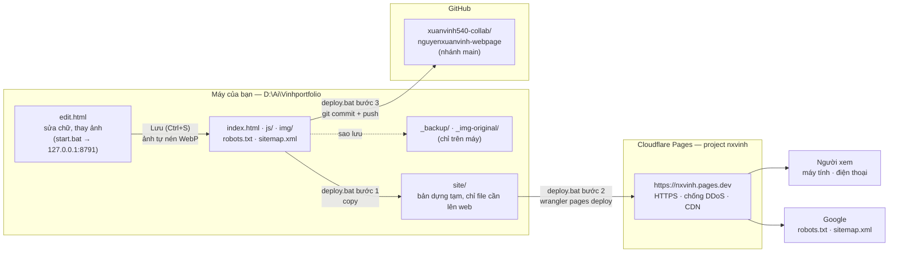
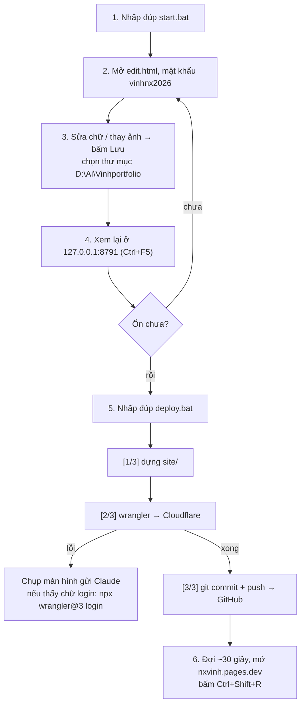
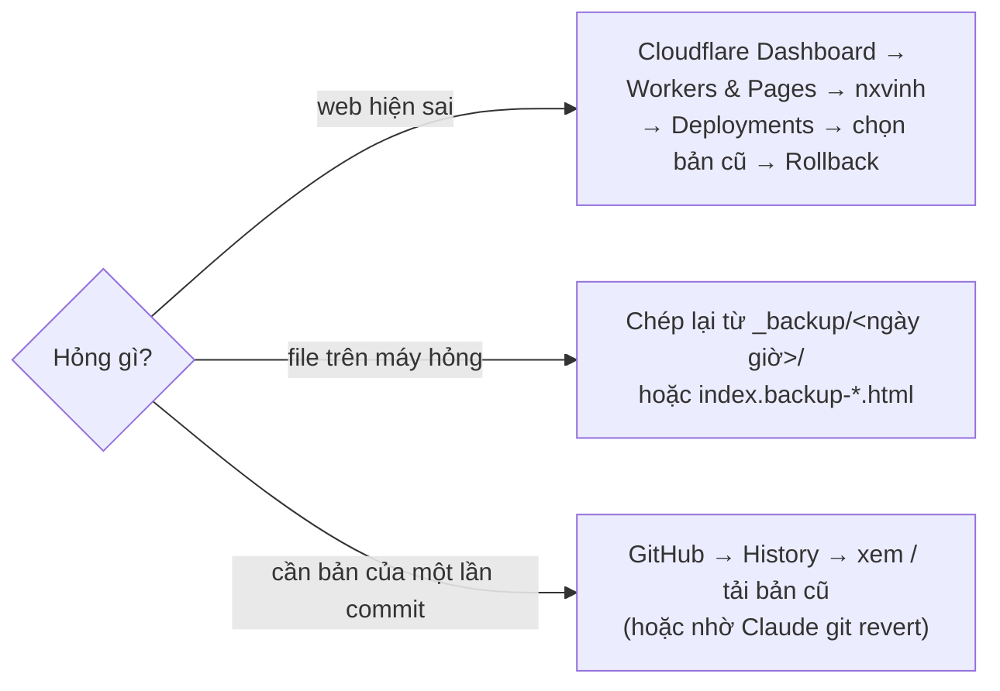

# Hướng dẫn: Portfolio Archviz — Nguyen Xuan Vinh

Tài liệu ghi lại cấu trúc trang, cách chỉnh, cách đưa lên web và quy trình làm một trang tương tự từ đầu.

- Trang web: https://nxvinh.pages.dev (Cloudflare Pages, project `nxvinh`)
- Mã nguồn: https://github.com/xuanvinh540-collab/nguyenxuanvinh-webpage (nhánh `main`)
- Thư mục trên máy: `D:\Ai\Vinhportfolio`

---

## 1. Cấu trúc thư mục

| Đường dẫn | Là gì | Lên web? |
| --- | --- | --- |
| `index.html` | Toàn bộ trang: nội dung, CSS, các script nhỏ (cuộn, gallery, trang edit) | Có |
| `js/name-particles.js` | Hiệu ứng chữ NGUYEN / XUAN VINH: giãn dọc → khối 3D → mảnh Voronoi → hạt → ghép thành ảnh hero | Có |
| `js/fly-gl.js` | Chuyển cảnh WebGL (Three.js) cho phần ảnh cuộn đầu trang | Có |
| `js/hover-gl.js` | Ảnh bên dưới gợn sóng ~1 giây khi rê chuột | Có |
| `img/pdf/` | Ảnh tách từ PDF portfolio | Có |
| `img/uploads/` | Ảnh thay hoặc thêm bằng trang edit (tự nén khi lưu) | Có |
| `img/clients/` | Logo khách hàng | Có |
| `img/about/vinh.jpg` | Ảnh chân dung | Có |
| `edit.html` | Lối tắt mở chế độ sửa (`index.html?edit`) | Không |
| `start.bat` | Bật server trên máy để xem trang (bắt buộc cho WebGL và trang edit) | Không |
| `deploy.bat` | Nhấp đúp để đưa lên web và lưu GitHub (xem mục 4) | Không |
| `_img-original/`, `_backup/` | Ảnh gốc chưa nén, các bản sao lưu | Không |
| `_pdf/`, `imgs/`, `client/` | Tư liệu gốc (PDF tách trang, ảnh nguồn, logo gốc) | Không |
| `site/` | Bản dựng tạm để deploy (tạo lại mỗi lần) | Không |
| `index.backup-*.html` | Bản sao lưu tự tạo mỗi lần lưu trong trang edit | Không |

Các mục "Không" đã nằm trong `.gitignore`.

---

## 2. Kiến trúc trang (từ trên xuống)

1. **Hero tên** (`#orbitWrap` / `.orbit`): nền xanh rêu có đường đồng mức động, chữ NGUYEN (neon) / XUAN VINH (trắng). Cuộn xuống thì chữ vỡ thành hạt và ghép thành ảnh hero.
2. **Ảnh cuộn** (`#fly`): 3 cảnh (Asni Marrakech vườn → sảnh → Kaan Dakhla). Cuộn = zoom vào ảnh, sang ảnh mới bằng chuyển cảnh WebGL gợn sóng.
3. **Dải chữ chạy** (`.ticker`).
4. **Giới thiệu** (`#about`): ảnh chân dung cao bằng đoạn giới thiệu, chữ ký.
5. **Selected works** (`#works`): 5 dự án lớn, có parallax, hiệu ứng mở ảnh và gợn sóng khi rê chuột.
6. **Exterior / Interior**: hai thẻ lớn, bấm mở gallery kéo ngang.
7. **Masterplans**: 3 thẻ + ô "view all".
8. **Footer** (`#contact`): logo khách hàng chạy hai hàng, email, điện thoại.

**Màu** (biến CSS trong `:root` của `index.html`):

| Biến | Màu | Dùng cho |
| --- | --- | --- |
| `--bg` | `#262b1f` xanh rêu | Nền |
| `--accent` | `#d4ff00` xanh neon | NGUYEN, số thứ tự, điểm nhấn |
| `--coffee` | `#a57c56` nâu cafe | Đường đồng mức, câu phụ trong phần giới thiệu |
| `--ink` | `#f7f7f2` trắng | Chữ |

**Font:** Anton (chữ lớn), Inter (chữ thường), tải từ Google Fonts.
**Thư viện:** Three.js 0.160 (WebGL), Lenis 1.1.13 (cuộn mượt), tải từ unpkg.

---

## 3. Việc hằng ngày

### Xem trang trên máy
Nhấp đúp `start.bat` → trang mở ở `http://127.0.0.1:8791/`. Giữ cửa sổ đen mở trong lúc xem.
Không nhấp đúp thẳng `index.html`: trình duyệt sẽ chặn WebGL và trang edit.

### Sửa chữ / thay ảnh (không cần code)
1. Mở `http://127.0.0.1:8791/edit.html`, mật khẩu `vinhnx2026`.
2. Bấm vào chữ để sửa. Rê chuột lên ảnh → **thay ảnh** / **xóa**. Cuối gallery có **+ thêm ảnh**.
3. Bấm **Lưu** (Ctrl+S) → chọn đúng thư mục `D:\Ai\Vinhportfolio`.
   - Ảnh mới tự nén (cạnh dài 2000px, JPG 85%) vào `img/uploads/`.
   - Bản cũ tự sao lưu thành `index.backup-….html`.
4. Cần Chrome hoặc Edge.

Đổi mật khẩu: mở Console trên trang, chạy `await adminHash("mat-khau-moi")`, dán kết quả vào `ADMIN_HASH` trong `index.html`.

### Đổi ảnh của phần cuộn đầu trang
Thay 3 ảnh trong khối `<section class="fly">` (bằng trang edit hoặc sửa `src`). Hiệu ứng hạt tự ghép theo ảnh đầu tiên. Sửa tên dự án ở `#heroTitle` và 3 dòng `.caption`.

### Chỉnh hiệu ứng (số ở đầu mỗi file JS)
- `js/name-particles.js`
  - `STRETCH`: độ giãn dọc của chữ
  - `LAYERS`, `THICK`: độ đặc / dày khối 3D (nhiều = đẹp hơn nhưng nặng hơn)
  - `CELLS`, `SHARP`: số mảnh Voronoi, độ nhọn
  - `BREAK_END`, `BG_FADE`: nhịp vỡ và lúc ảnh hero hiện ra
- `js/hover-gl.js`: `DURATION` (ms), `STRENGTH`
- `js/fly-gl.js`: đổi độ gợn trong shader (`glitch`, `rip`)

Sau khi sửa file JS, tăng số `?v=` trong thẻ `<script>` ở cuối `index.html` để trình duyệt lấy bản mới.

---

## 4. Đưa lên web và lưu GitHub

### 4.1 Sơ đồ tổng thể



Ý chính:
- **Nguồn thật** là thư mục trên máy. GitHub chỉ để lưu lịch sử; Cloudflare chỉ nhận thư mục `site/`.
- Push GitHub **không** tự cập nhật web, và deploy web **không** tự lưu GitHub. `deploy.bat` làm cả hai.
- Những thứ chỉ để trên máy (`_backup/`, `_img-original/`, `_pdf/`, `imgs/`, `client/`, `edit.html`, `start.bat`) không bao giờ lên web.

### 4.2 Quy trình mỗi lần cập nhật



### 4.3 Quay lại bản cũ



### 4.4 Lệnh tay (khi không dùng deploy.bat)

Chạy trong Git Bash, tại `D:\Ai\Vinhportfolio`:

```bash
# 1. sao lưu (khuyên làm trước mỗi lần deploy lớn)
S=$(date +%Y%m%d-%H%M); mkdir -p _backup/$S && cp -r index.html js img _backup/$S/

# 2. dựng thư mục deploy (chỉ những gì cần lên web)
rm -rf site && mkdir site && cp index.html robots.txt sitemap.xml site/ && cp -r js img site/

# 3. deploy Cloudflare Pages
npx wrangler@3 pages deploy site --project-name nxvinh --branch main --commit-dirty=true

# 4. lưu lên GitHub
git add -A && git commit -m "Mô tả thay đổi" && git push
```

- Lần đầu dùng wrangler trên máy mới: `npx wrangler@3 login`.
- Quay lại bản cũ trên web: Cloudflare Dashboard → Workers & Pages → `nxvinh` → Deployments → chọn bản cũ → Rollback.
- Hai nơi chưa nối với nhau: push GitHub **không** tự cập nhật web. Muốn tự động thì ở Cloudflare chọn Create → Pages → Connect to Git (sẽ là project mới).

---

## 5. Quy trình làm một trang tương tự từ đầu

Thời gian ước tính khi làm cùng Claude Code: 1–2 buổi.

### Bước 1 — Chuẩn bị tư liệu (người làm)
- PDF portfolio hoặc thư mục ảnh render theo từng dự án (tên file nên có tên dự án).
- 3–4 ảnh cùng một dự án cho phần cuộn đầu trang (xa → gần → nội thất → view).
- Ảnh chân dung, logo khách hàng, email, điện thoại.
- Ảnh tham khảo kiểu trang muốn giống (ví dụ landonorris.com) và bảng màu.

### Bước 2 — Tách ảnh từ PDF
PDF xuất từ InDesign/PowerPoint thường mỗi trang là một ảnh phẳng, không có chữ.
- Cài: `python -m pip install pymupdf pillow numpy`
- Tách ảnh lớn của từng trang, rồi cắt từng ảnh con theo khoảng trắng giữa các ảnh.
- Gắn tên dự án theo chú thích trên trang PDF, ghi lại để điền vào trang.

### Bước 3 — Dựng khung trang
Tạo thư mục mới, chép `index.html` + `js/` của trang này làm mẫu, rồi thay:
- tên, màu (`:root`), nội dung từng phần, đường dẫn ảnh;
- logo khách hàng vào `img/clients/` (đổi tên file không dấu, không khoảng trắng).

### Bước 4 — Nén ảnh
Cạnh dài 2000px, JPG chất lượng ~82%. Giữ bản gốc ở `_img-original/`. Trang này giảm từ 60MB xuống 24MB.

### Bước 5 — Kiểm tra
- Mở qua `start.bat`, cuộn chậm qua phần đầu, rê chuột vào ảnh.
- Thử khổ điện thoại (F12 → biểu tượng điện thoại): không bị tràn ngang, ảnh xếp một cột.
- F12 → Console không có dòng đỏ.

### Bước 6 — Đưa lên
Tạo project Cloudflare Pages mới (`npx wrangler@3 pages project create <ten> --production-branch main`), deploy như mục 4, tạo repo GitHub trống rồi push.

---

## 6. Câu lệnh mẫu để nhờ Claude Code

Dán vào Claude Code, sửa phần trong `< >`:

> Làm trang portfolio archviz cá nhân trong `<thư mục mới>`, dựa trên mẫu `D:\Ai\Vinhportfolio` (đọc `HUONG-DAN.md` trước).
> Tư liệu: PDF `<đường dẫn>`, logo khách hàng `<thư mục>`, ảnh chân dung `<file>`.
> Tên hiển thị `<HỌ TÊN>`, email `<email>`, điện thoại `<số>`.
> Phần cuộn đầu trang dùng 3 ảnh `<file 1, 2, 3>`.
> Màu: nền `<màu>`, nhấn `<màu>`, phụ `<màu>`.
> Tách ảnh từ PDF, gắn đúng tên dự án, nén ảnh, giữ nguyên các hiệu ứng, kiểm tra trên trình duyệt. Chưa deploy cho tới khi mình duyệt.

---

## 7. Lỗi hay gặp

| Hiện tượng | Nguyên nhân | Cách xử lý |
| --- | --- | --- |
| Không thấy hiệu ứng WebGL, trang edit không lưu được | Mở bằng `file:///` | Mở bằng `start.bat` |
| Sửa JS mà trang không đổi | Trình duyệt nhớ bản cũ | Ctrl+F5, hoặc tăng `?v=` trong thẻ `<script>` |
| Lưu trong trang edit báo "could not be found" | Chọn nhầm thư mục | Chọn đúng `D:\Ai\Vinhportfolio` (thư mục chứa `index.html`) |
| Không bấm được chữ ở phần ảnh cuộn trong chế độ sửa | Lớp chữ tên phía trên còn đè | Đã sửa; nếu tái diễn, kiểm tra lớp `.orbit.gone` |
| Logo khách hàng bị cắt | Ảnh tràn khung | `.logo img` phải có `width/height: 100%` và `object-fit: contain` |
| Trang nặng, giật khi cuộn đầu trang | Quá nhiều hạt | Giảm `LAYERS` trong `name-particles.js` |
| `start.bat` báo cổng 8791 đang dùng | Đã có server khác chạy | Mở thẳng `http://127.0.0.1:8791/` hoặc tắt server cũ |

---

## 8. Lưu ý

- Chỉ đăng ảnh dự án khi được công ty / chủ đầu tư đồng ý.
- Bật xác thực hai bước (2FA) cho tài khoản GitHub và Cloudflare.
- Tên miền: hiện dùng `nxvinh.pages.dev` (miễn phí). Mua tên miền riêng thì gắn ở Cloudflare → `nxvinh` → Custom domains; link `.pages.dev` vẫn chạy song song.
